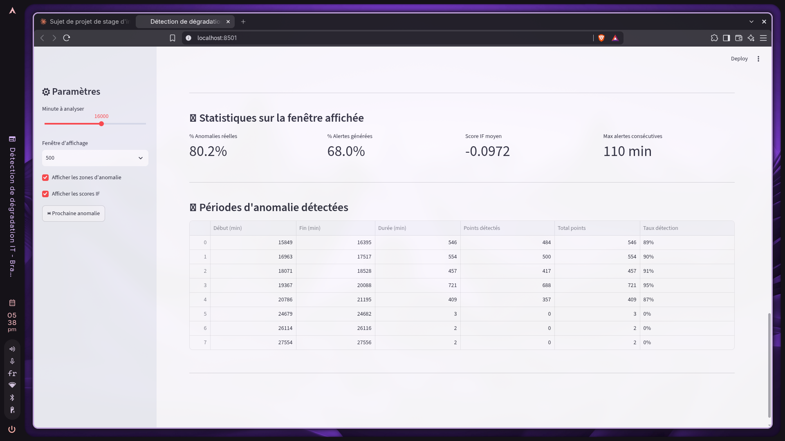
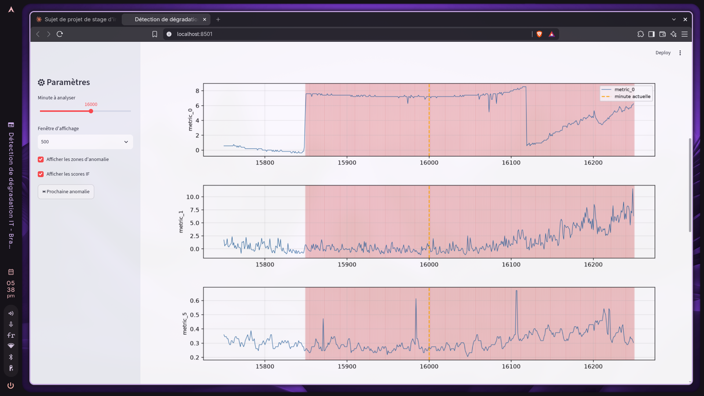
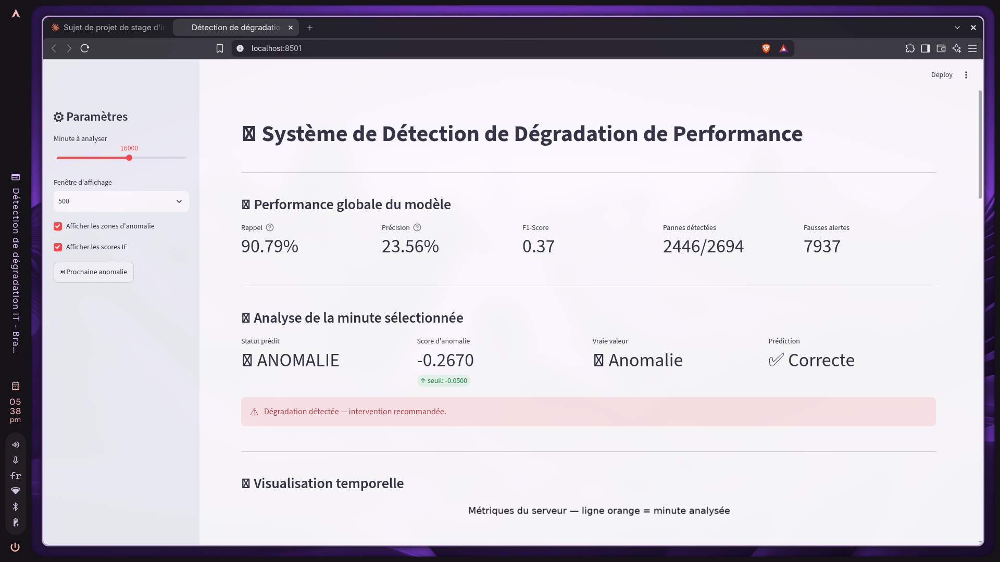

# Performance Degradation Prediction — ML Pipeline

> Système de détection de dégradation de performance applicative basé sur le Machine Learning  
> **Amine El-Baydaouy** — Étudiant ingénieur Data Science & IA, ENSAM Rabat — Stage BunionTech 2025

---

## 📋 Présentation du projet

Ce projet vise à passer d'une supervision IT **réactive** (alertes après incident) à une supervision **prédictive** (détection avant impact). Un modèle d'Isolation Forest analyse en continu les métriques système d'un serveur et détecte les comportements anormaux avant qu'ils n'impactent les utilisateurs.

---

## 🏗️ Architecture du pipeline

```
Données brutes (SMD)
        ↓
Analyse exploratoire (EDA)
        ↓
Prétraitement (features, fenêtres, normalisation)
        ↓
Modélisation (Isolation Forest + Autoencoder LSTM)
        ↓
API REST (FastAPI)
        ↓
Dashboard (Streamlit)
```

---

## 📊 Dataset — Server Machine Dataset (SMD)

| Caractéristique | Valeur |
|---|---|
| Machines (serveurs) | 28 |
| Métriques par machine | 38 |
| Fréquence | 1 mesure / minute |
| Durée par machine | ~5 semaines |
| Taux d'anomalie | 9.5% |

**Source :** [OmniAnomaly — NetManAIOps](https://github.com/NetManAIOps/OmniAnomaly)

---

## 📈 Analyse exploratoire

### Comportement des métriques (train)


### Zones d'anomalie sur le test


### Corrélations entre métriques


---

## 🤖 Modèles

### Isolation Forest
| Métrique | Valeur |
|---|---|
| Rappel | 0.91 |
| Précision | 0.24 |
| F1-Score | 0.37 |
| Seuil | -0.05 |

### Autoencoder LSTM
| Métrique | Valeur |
|---|---|
| Rappel | 0.50 |
| Précision | 0.24 |
| F1-Score | 0.32 |

**Modèle retenu : Isolation Forest** — meilleur rappel, priorité à ne pas rater de pannes.

---

## 🖥️ Dashboard

### KPIs globaux et analyse temps réel


### Visualisation temporelle des métriques


### Historique des anomalies


---

## 🚀 Installation et lancement

### 1. Cloner le repo
```bash
git clone https://github.com/amine-mlops/performance-degradation-prediction.git
cd performance-degradation-prediction
```

### 2. Créer l'environnement virtuel
```bash
python3.12 -m venv venv
source venv/bin/activate
pip install -r requirements.txt
```

### 3. Télécharger le dataset
```bash
git clone https://github.com/NetManAIOps/OmniAnomaly.git
mkdir -p data/smd
cp -r OmniAnomaly/ServerMachineDataset/* data/smd/
```

### 4. Lancer le preprocessing
```bash
cd src
python preprocessing.py
```

### 5. Entraîner le modèle
```bash
python model_if.py
```

### 6. Lancer l'API
```bash
cd ..
uvicorn src.api:app --reload --port 8000
```

### 7. Lancer le dashboard
```bash
streamlit run src/dashboard.py
```

Dashboard disponible sur `http://localhost:8501`

---

## 🐳 Docker

```bash
docker build -t degradation-api .
docker run -p 8000:8000 degradation-api
```

---

## 🔌 API REST

| Endpoint | Méthode | Description |
|---|---|---|
| `/health` | GET | Vérifier que l'API tourne |
| `/info` | GET | Infos sur le modèle |
| `/predict` | POST | Prédire une anomalie |

### Exemple de requête
```bash
curl -X POST http://localhost:8000/predict \
  -H "Content-Type: application/json" \
  -d '{"metrics": [0.032, 0.041, ...]}'  # 128 valeurs
```

### Exemple de réponse
```json
{
  "prediction": 1,
  "score": -0.352,
  "status": "anomalie",
  "message": "Dégradation détectée — intervention recommandée."
}
```

---

## 📁 Structure du projet

```
degradation_prediction/
├── data/smd/               # Dataset SMD
├── src/
│   ├── data_loader.py      # Chargement des données
│   ├── eda.py              # Analyse exploratoire
│   ├── preprocessing.py    # Prétraitement
│   ├── model_if.py         # Isolation Forest
│   ├── model_lstm.py       # Autoencoder LSTM
│   ├── api.py              # API FastAPI
│   └── dashboard.py        # Dashboard Streamlit
├── images/                 # Visualisations et screenshots
├── outputs/                # Modèles et données prétraitées
├── Dockerfile
├── requirements.txt
└── README.md
```

---

## 🛠️ Stack technique

| Composant | Technologie |
|---|---|
| Langage | Python 3.12 |
| Machine Learning | scikit-learn |
| Deep Learning | TensorFlow / Keras |
| API | FastAPI |
| Dashboard | Streamlit |
| Conteneurisation | Docker |
| Versioning | Git / GitHub |

---

## 👤 Auteur

**Amine El-Baydaouy**  
Étudiant ingénieur — Data Science & Intelligence Artificielle  
ENSAM Rabat — Université Mohammed V  
Stage d'initiation chez **BunionTech** — 2025
