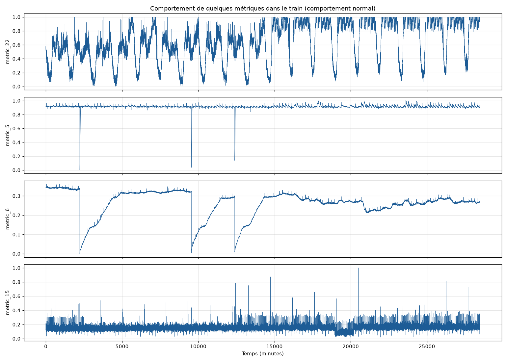
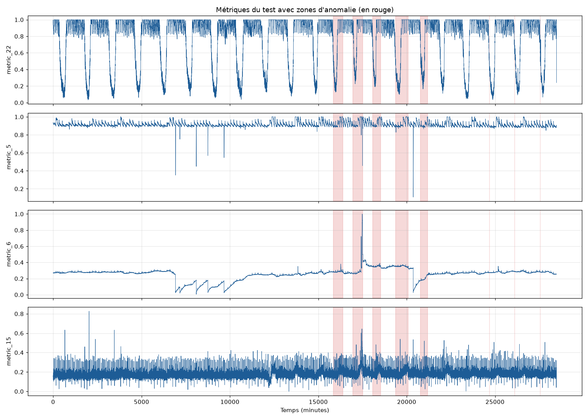
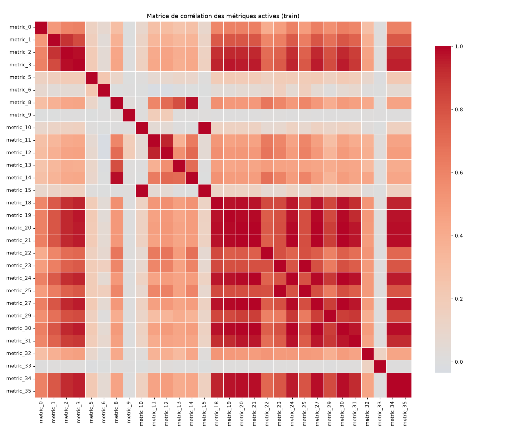
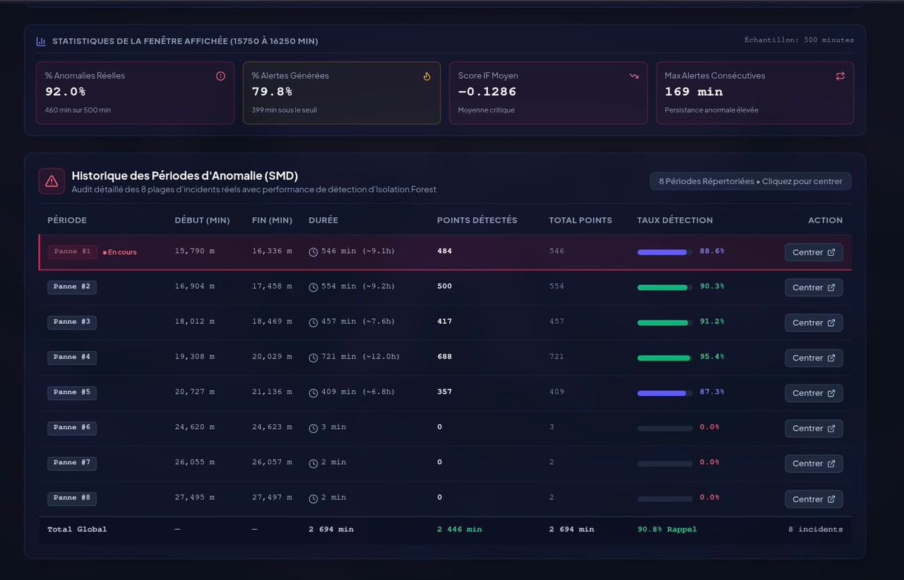
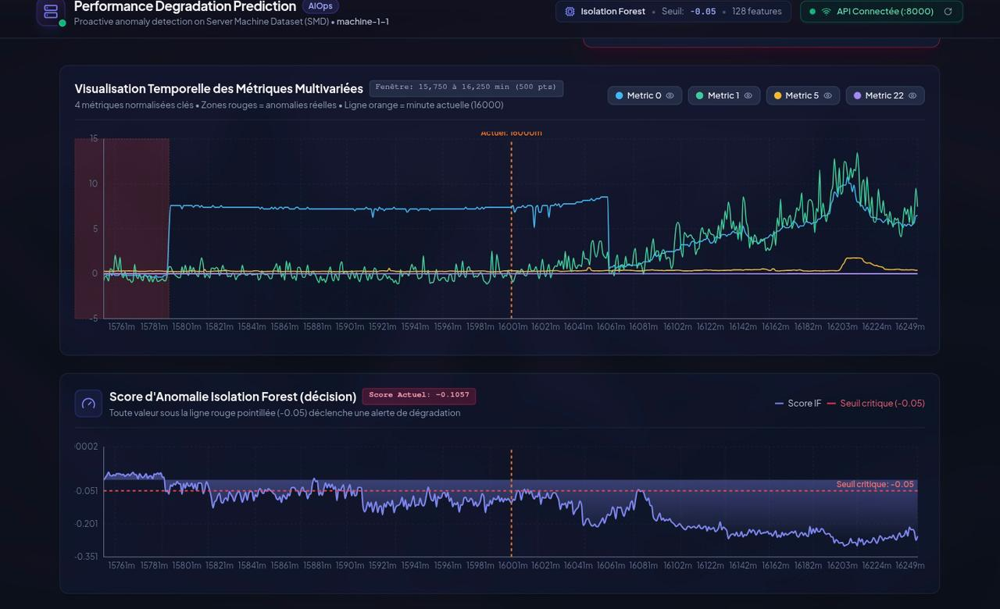
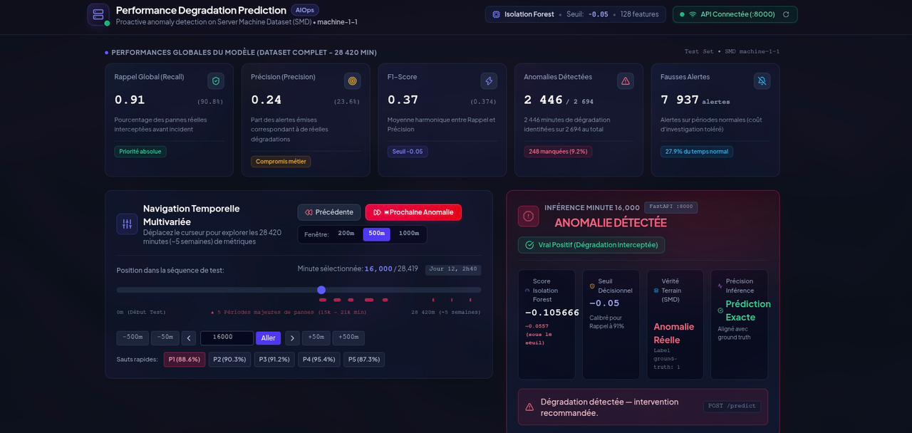

# Performance Degradation Prediction - ML Pipeline

> Machine Learning-based system for predicting application performance degradation in IT infrastructures.  
> **Amine El-Baydaouy** - Data Science & AI Engineering Student, ENSAM Rabat - BunionTech Internship 2026

---

## Project Overview

This project addresses the limitations of traditional IT monitoring systems, which rely on static thresholds and detect incidents only after they have already impacted users. The proposed solution shifts from a **reactive** approach to a **predictive** one: an Isolation Forest model continuously analyzes server metrics and detects abnormal behaviors before they affect end users.

---

## Pipeline Architecture

```
Raw Data (SMD)
        |
Exploratory Data Analysis (EDA)
        |
Preprocessing (features, windows, normalization)
        |
Modeling (Isolation Forest + Autoencoder LSTM)
        |
REST API (FastAPI)
        |
Dashboard (Streamlit)
```

---

## Dataset - Server Machine Dataset (SMD)

| Property | Value |
|---|---|
| Machines (servers) | 28 |
| Metrics per machine | 38 |
| Sampling frequency | 1 measurement / minute |
| Duration per machine | ~5 weeks |
| Anomaly rate | 9.5% |

**Source:** [OmniAnomaly - NetManAIOps](https://github.com/NetManAIOps/OmniAnomaly)

---

## Exploratory Data Analysis

### Metrics behavior (training set)


### Anomaly zones on the test set


### Correlation matrix between metrics


---

## Models

### Isolation Forest

| Metric | Value |
|---|---|
| Recall | 0.91 |
| Precision | 0.24 |
| F1-Score | 0.37 |
| Decision threshold | -0.05 |

### Autoencoder LSTM

| Metric | Value |
|---|---|
| Recall | 0.50 |
| Precision | 0.24 |
| F1-Score | 0.32 |

**Selected model: Isolation Forest** - highest recall, aligned with the business priority of not missing critical failures.

---

## Dashboard

### Anomaly history


### Temporal visualization of metrics


### Global KPIs and real-time analysis


---

## Installation and Setup

### 1. Clone the repository
```bash
git clone https://github.com/amine-mlops/performance-degradation-prediction.git
cd performance-degradation-prediction
```

### 2. Create a virtual environment
```bash
python3.12 -m venv venv
source venv/bin/activate
pip install -r requirements.txt
```

### 3. Download the dataset
```bash
git clone https://github.com/NetManAIOps/OmniAnomaly.git
mkdir -p data/smd
cp -r OmniAnomaly/ServerMachineDataset/* data/smd/
```

### 4. Run preprocessing
```bash
cd src
python preprocessing.py
```

### 5. Train the model
```bash
python model_if.py
```

### 6. Start the API
```bash
cd ..
uvicorn src.api:app --reload --port 8000
```

### 7. Launch the dashboard
```bash
streamlit run src/dashboard.py
```

Dashboard available at `http://localhost:8501`

---

## Docker

```bash
docker build -t degradation-api .
docker run -p 8000:8000 degradation-api
```

---

## REST API

| Endpoint | Method | Description |
|---|---|---|
| `/health` | GET | Check API status |
| `/info` | GET | Model information |
| `/predict` | POST | Predict anomaly from metrics |

### Sample request
```bash
curl -X POST http://localhost:8000/predict \
  -H "Content-Type: application/json" \
  -d '{"metrics": [0.032, 0.041, ...]}'
```

### Sample response
```json
{
  "prediction": 1,
  "score": -0.352,
  "status": "anomalie",
  "message": "Degradation detected - intervention recommended."
}
```

---

## Project Structure

```
degradation_prediction/
├── data/smd/               # SMD dataset
├── src/
│   ├── data_loader.py      # Data loading module
│   ├── eda.py              # Exploratory data analysis
│   ├── preprocessing.py    # Data preprocessing pipeline
│   ├── model_if.py         # Isolation Forest model
│   ├── model_lstm.py       # Autoencoder LSTM model
│   ├── api.py              # FastAPI REST API
│   └── dashboard.py        # Streamlit dashboard
├── images/                 # Visualizations and screenshots
├── outputs/                # Trained models and preprocessed data
├── Dockerfile
├── requirements.txt
└── README.md
```

---

## Tech Stack

| Component | Technology |
|---|---|
| Language | Python 3.12 |
| Machine Learning | scikit-learn |
| Deep Learning | TensorFlow / Keras |
| API | FastAPI |
| Dashboard | Streamlit |
| Containerization | Docker |
| Version Control | Git / GitHub |

---

## Author

**Amine El-Baydaouy**  
Engineering Student - Data Science and Artificial Intelligence  
Ecole Nationale Superieure d'Arts et Metiers, Rabat - Universite Mohammed V  
Internship at **BunionTech** - 2026

